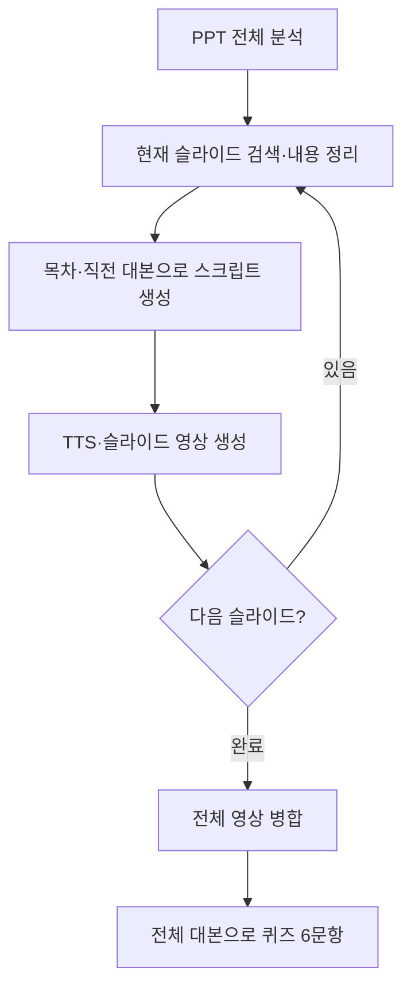

# AI 강사 Agent

**슬라이드마다 따로 생성되던 대본을, 하나의 강의 흐름으로 연결했습니다.**

PPTX의 텍스트·표·이미지를 분석하고, 대본과 음성을 생성해 여러 슬라이드를 한 편의 MP4로 완성하는 LangGraph 프로젝트입니다. 강의 전체를 바탕으로 복습 퀴즈 6문항을 만들고 Gradio에서 영상과 정답을 확인할 수 있습니다.

[](https://github.com/withoutsultang/PPT_Agent_aivle/actions/workflows/tests.yml)

| 프로젝트 | 내용 |
|---|---|
| 배경 | KT AIVLE School AI 트랙 미니프로젝트 3차 |
| 개발자 | [김건우](https://github.com/withoutsultang) |
| 주요 담당 | 강의 스크립트 고도화 공동 담당, 슬라이드 전환 멘트 프롬프트 보완 |
| 핵심 기술 | Python · LangGraph · OpenAI · python-pptx · SerpAPI · FFmpeg · Gradio |

## 제가 집중한 문제와 구현

여러 슬라이드의 영상을 이어 붙이려면 대본도 하나의 강의처럼 이어져야 합니다. 현재 페이지의 요약만 입력하는 구조에서는 장이 바뀔 때마다 인사나 마무리가 반복될 수 있었습니다. 저는 스크립트 고도화를 공동 담당하고, 전환 멘트 보완을 맡아 **강의 문맥을 입력에 반영하고 위치별 작성 규칙을 구체화**했습니다.

| 기여 | 구현 | 드러나는 역량 |
|---|---|---|
| 강의 문맥을 반영하는 대본 생성 | 전체 목차·현재 슬라이드·직전 대본을 함께 전달 | 생성 품질 요구를 입력 구조로 전환 |
| 슬라이드 위치별 흐름 제어 | 첫 장은 도입, 중간은 본론 연결, 마지막은 요약과 끝인사 | 조건별 프롬프트 설계 |
| 전환 멘트 보완 | 반복 인사를 제한하고 연속 강의라는 목적을 명시 | 추상적인 ‘자연스러움’을 실행 가능한 규칙으로 구체화 |
| 후속 단계에서 대본 재사용 | 현재 `script`와 누적 `all_scripts`를 관리 | 노드 간 데이터 연계와 전체 강의 기반 퀴즈 연결 |

구현은 [대본 프롬프트](prompts.py)와 [스크립트 생성 노드](agent_nodes.py)에서 확인할 수 있습니다. 당시 담당 기록과 코드의 연결은 [개발 기록](docs/project-history.md)에 정리했습니다.

## 팀이 완성한 결과

팀은 단일 슬라이드 실습을 여러 슬라이드의 강의 제작으로 확장했습니다. 전체 PPT 파싱, 외부 검색, 문맥형 대본, TTS, 슬라이드별 영상, 최종 병합, 퀴즈를 하나의 그래프로 연결했습니다. 저는 그 흐름에 들어가는 **대본 생성과 전환 표현**을 담당했습니다.

| 저장된 실행 사례 | 결과 |
|---|---|
| 3슬라이드 입력 | 강의 영상 **4분 5초**, 대본 3개, 퀴즈 **6문항** |
| 7슬라이드 입력 | 강의 영상 **9분 2초**로 병합 |
| Gradio에서 3슬라이드 실행 | 강의 영상 **4분 43초**, 퀴즈 **6문항** |

팀 최종 노트북의 저장 로그 기준입니다. 시간은 완성 영상의 **재생 길이**이며, 제작 소요시간을 뜻하지 않습니다. [실행 기록 위치](docs/project-history.md#실행-기록)를 함께 남겼습니다.

## 사용 화면


프로젝트 당시 화면입니다. 현재 실행 화면은 같은 흐름으로 업로드·말투·목소리·스타일·목표 분량·재생 속도와 결과 확인을 제공합니다.

## 동작 구조



- **한 번 분석하고 슬라이드별로 처리:** PPT 객체와 전체 목차는 처음에 수집하고, 현재 인덱스에 맞춰 생성 단계를 반복합니다.
- **설명과 대본을 구분:** 슬라이드 근거를 정리한 `page_content`를 만든 뒤 강의 흐름을 반영해 `script`를 작성합니다.
- **현재 문맥과 전체 결과를 함께 관리:** 직전 대본은 다음 장의 생성에, 누적 대본은 전체 강의 복습에 사용합니다.

[State와 모듈 설명](docs/architecture.md)

## 실행하기

Python **3.11 이상**과 FFmpeg, LibreOffice, Poppler가 필요합니다.

### 1. 설치

```bash
git clone https://github.com/withoutsultang/PPT_Agent_aivle.git
cd PPT_Agent_aivle
python -m venv .venv
```

```bash
# macOS / Linux
source .venv/bin/activate
# Windows PowerShell
# .venv\Scripts\Activate.ps1

python -m pip install -r requirements.txt
```

운영체제별 미디어 도구 설치:

```bash
# Ubuntu / Debian
sudo apt-get update
sudo apt-get install -y ffmpeg libreoffice poppler-utils fonts-noto-cjk

# macOS (Homebrew)
# brew install ffmpeg poppler
# brew install --cask libreoffice
```

Windows에서는 FFmpeg·LibreOffice·Poppler를 설치하고 `ffmpeg`, `ffprobe`, `soffice`, `pdftoppm`이 PATH에서 실행되도록 설정합니다. PPT에 사용한 한글 폰트도 설치해 주세요.

### 2. API 설정

`.env.example`을 `.env`로 복사하고 값을 입력합니다.

```dotenv
OPENAI_API_KEY=발급받은_키
# 외부 검색을 함께 사용할 때 설정
SERPAPI_API_KEY=발급받은_키
```

`SERPAPI_API_KEY` 없이도 PPT 내용으로 생성할 수 있습니다. 모델은 `.env`의 `LLM_MODEL`, `TTS_MODEL`로 선택합니다. `.env`와 생성 파일은 Git에서 제외됩니다. 실행 시 OpenAI API 사용 요금이 발생합니다.

### 3. 시작

```bash
python app.py
```

터미널에 표시된 로컬 주소를 열어 PPTX를 올리고 **강의 만들기**를 누릅니다. 목표 분량은 대본 작성 기준이며 재생 속도는 별도로 조절합니다. 출력 음성은 AI로 생성됩니다. 필요할 때 `GRADIO_SHARE=true`로 임시 공유를 켤 수 있습니다.

## 저장되는 결과

실행마다 `outputs/lecture-…/` 폴더가 생성됩니다.

| 결과 | 위치 |
|---|---|
| 슬라이드별 대본 | `scripts/slide-001.txt` 등 |
| 음성 / 슬라이드 영상 | `audio/` / `videos/` |
| 전체 강의 영상 | `final_lecture.mp4` |
| 복습 퀴즈와 정답 | `quizzes.json` |
| 입력 옵션·슬라이드 수·실제 재생 길이 | `result.json` |

## 코드 안내와 검증

| 파일 | 역할 |
|---|---|
| [prompts.py](prompts.py) | 전체 목차·직전 대본·슬라이드 위치별 프롬프트 |
| [agent_nodes.py](agent_nodes.py) | PPT 분석, 검색, 생성, 음성, 영상, 퀴즈 노드 |
| [pipeline.py](pipeline.py) | StateGraph 연결, 입력 검증, 실행별 작업 폴더 |
| [app.py](app.py) | Gradio 입력과 결과 표시 |
| [utils.py](utils.py) | 텍스트 정리, PPT 렌더링, FFmpeg 처리 |
| [tests/](tests/) | 프롬프트·퀴즈·실제 그래프·미디어 회귀 테스트 |

```bash
python -m pip install -r requirements-dev.txt
python -m pytest -q
```

자동 검증은 API 모의 응답으로 실제 LangGraph의 1·3·20장 반복과 대본/퀴즈 연계를 확인하고, FFmpeg로 짧은 영상을 실제 인코딩·병합합니다. 유료 모델 호출 검증과는 구분합니다. GitHub Actions에서도 같은 검증을 실행합니다.

## 프로젝트 기반과 협업

교육기관이 제공한 과제·실습 틀·예시를 바탕으로 AI05반 9조가 공동 개발했습니다. 저장소는 [이수빈 님의 초기 PPT_Agent](https://github.com/leesupin/PPT_Agent)에서 이어졌으며, 원래 커밋 이력을 유지합니다. 개인 기여는 스크립트 생성 고도화와 전환 프롬프트 보완을 중심으로 설명했습니다.

2026년 저장소 정비에서는 모듈 실행 경로, 생성 결과 검증, 작업 폴더 분리와 회귀 테스트를 정리했습니다. 당시 개발 기록과 현재의 정비 이력은 [개발 기록](docs/project-history.md)에서 구분합니다.
